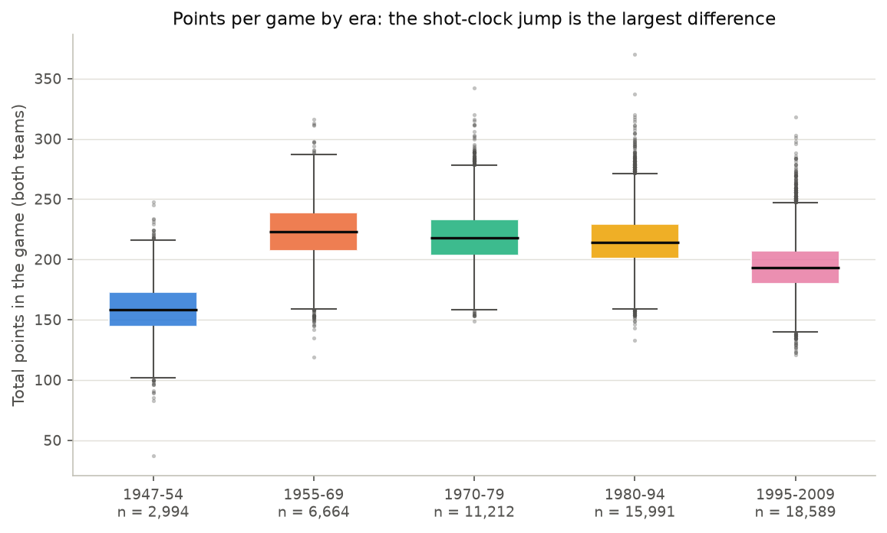

<div align="center">

# 🏀 NBA Elo EDA

**A four-part exploratory analysis of 60 years of NBA games (FiveThirtyEight's NBA All Elo, ~111k rows): data quality, distributions and outliers, bivariate structure, stratification, confounding, χ² tests and PCA.**


English · [Русский](README.ru.md)

</div>

---

<p align="center"></p>

## Parts

| Notebook | Focus |
|---|---|
| [01 · Data quality](01_data_quality.ipynb) | structure, types, missing values, duplicates (every game appears twice, once per team), sanity checks |
| [02 · Distributions & outliers](02_distributions_outliers.ipynb) | points, Elo and margin of victory; mean vs median, IQR outliers you should *not* delete, robust statistics, transformations |
| [03 · Bivariate relationships](03_bivariate.ipynb) | Pearson vs Spearman, non-linear relationships, numeric vs categorical, correlation matrix, why correlation is not causation |
| [04 · Groups & multivariate](04_groups_multivariate.ipynb) | group comparisons with effect sizes, stratification and confounding, partial correlation, χ² with Cramér's V, PCA |

## Key findings

- **Era explains about 35% of the variation in points per game; playoffs barely matter.** The largest jump is 1947–54 → 1955–69: the median rises by 65 points (Cohen's d = 2.72), in line with the introduction of the shot clock. Playoff games score only 4.5 points less (0.17 SD).
- **Stratification refines the picture, and no Simpson's paradox shows up.** The `pts`–`opp_pts` correlation falls from 0.64 overall to 0.45–0.55 within eras: part of it is shared era-level scoring. One apparent sign flip for favourites disappears once the strata are balanced.
- **Significant is not the same as important.** Playoffs × home result: χ² = 17.8, p = 2.4e−5, yet Cramér's V = 0.018, which is negligible. Elo favourite × result gives V = 0.29, a moderate effect. A Mantel–Haenszel stratification by Elo gap shrinks the playoff odds ratio from 1.17 to 1.09: stronger home teams explain part of the playoff home edge, and what remains shows up only when the home team is the Elo underdog.
- **PCA** splits the variables into almost independent blocks: score, ratings and time.
- Formulas (χ², Cramér's V, partial correlation) are coded by hand and checked against `scipy`.

The full write-up for part 4 is in [docs/part4_report.ru.md](docs/part4_report.ru.md) (in Russian), and all figures and tables are in [`results/`](results).

## Run

```bash
python -m venv .venv && source .venv/bin/activate
pip install -r requirements.txt
jupyter lab
```

The data is in [`data/nbaallelo.csv`](data/nbaallelo.csv) (FiveThirtyEight, CC BY 4.0). The notebooks download it if the file is missing.

## License

Code: [MIT](LICENSE). Data: FiveThirtyEight, CC BY 4.0.
