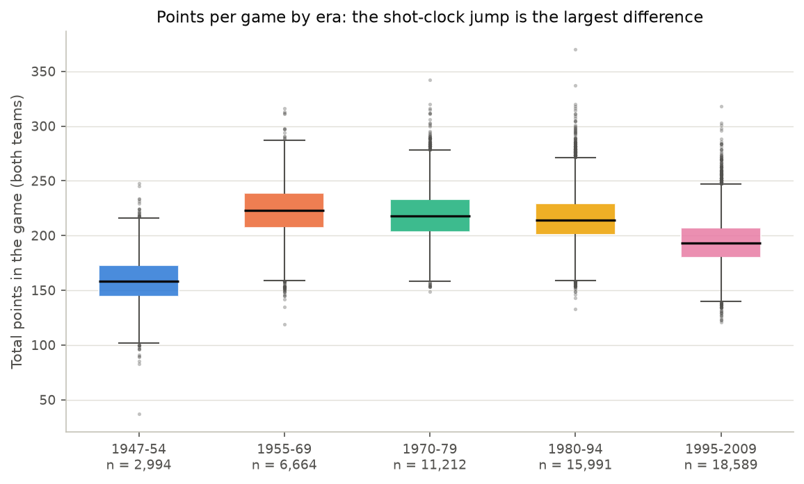

<div align="center">

# 🏀 NBA Elo EDA

**Исследовательский анализ 60 лет игр NBA в четырёх частях (FiveThirtyEight NBA All Elo, ~111 тыс. строк): качество данных, распределения и выбросы, парные связи, стратификация, конфаундинг, χ² и PCA.**


[English](README.md) · Русский

</div>

---

<p align="center"></p>

## Части

| Ноутбук | О чём |
|---|---|
| [01 · Качество данных](01_data_quality.ipynb) | структура, типы, пропуски, дубликаты (каждая игра записана дважды, по строке на команду), проверки на здравый смысл |
| [02 · Распределения и выбросы](02_distributions_outliers.ipynb) | очки, Elo и разница счёта; среднее против медианы, IQR-выбросы, которые *нельзя* удалять, робастные статистики, преобразования |
| [03 · Парные связи](03_bivariate.ipynb) | Пирсон против Спирмена, нелинейные связи, число против категории, корреляционная матрица, почему корреляция ≠ причинность |
| [04 · Группы и многомерный анализ](04_groups_multivariate.ipynb) | сравнение групп с размером эффекта, стратификация и конфаундинг, частная корреляция, χ² и V Крамера, PCA |

## Главные выводы

- **Эпоха объясняет около 35% вариации очков за игру, плей-офф почти ничего не меняет.** Самый большой скачок — 1947–54 → 1955–69: медиана выросла на 65 очков (d Коэна = 2.72), что совпадает с появлением 24-секундного правила. В плей-офф очков меньше всего на 4.5 (0.17 SD).
- **Стратификация уточняет картину, а парадокса Симпсона нет.** Корреляция `pts`–`opp_pts` падает с 0.64 в целом до 0.45–0.55 внутри эпох: часть связи — общий для эпохи уровень результативности. Кажущаяся смена знака у фаворитов исчезает при сбалансированных стратах.
- **Значимо не значит важно.** Плей-офф × результат хозяев: χ² = 17.8, p = 2.4e−5, но V Крамера = 0.018, то есть связь ничтожная. Статус фаворита по Elo × результат даёт V = 0.29, умеренная связь. Стратификация Мантеля–Хензеля по разнице Elo снижает OR плей-офф с 1.17 до 1.09: часть преимущества хозяев в плей-офф объясняется тем, что они сильнее, а остаток есть только там, где у хозяев Elo ниже.
- **PCA** делит переменные на почти независимые блоки: счёт, рейтинги, время.
- Формулы (χ², V Крамера, частная корреляция) написаны вручную и сверены со `scipy`.

Подробный отчёт по части 4 лежит в [docs/part4_report.ru.md](docs/part4_report.ru.md), все графики и таблицы — в [`results/`](results).

## Запуск

```bash
python -m venv .venv && source .venv/bin/activate
pip install -r requirements.txt
jupyter lab
```

Данные лежат в [`data/nbaallelo.csv`](data/nbaallelo.csv) (FiveThirtyEight, CC BY 4.0). Если файла нет, ноутбуки скачают его сами.

## Лицензия

Код: [MIT](LICENSE). Данные: FiveThirtyEight, CC BY 4.0.
